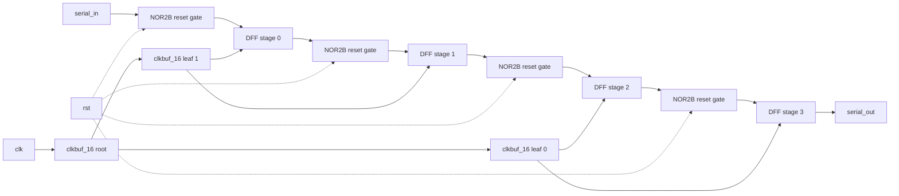
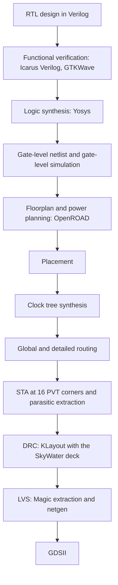

# 4-Stage Serial-In Serial-Out (SISO) Shift Register: RTL to GDSII on SKY130
PROJECT EXPLAINATION VIDEO=https://drive.google.com/file/d/1zmpX5CvGFHejlwKqmwbt2PsfJIOsHkxa/view?usp=drivesdk


A small digital design taken through the complete RTL-to-GDSII flow with open-source tools and the SkyWater SKY130 130 nm process: RTL, simulation, synthesis, floorplan, power planning, placement, clock tree synthesis, routing, static timing analysis at 16 PVT corners, parasitic extraction, DRC, LVS and a final GDSII layout.

**Author:** `< PURAM SAI BHASKAR >` | 
**Roll number:** `< 24EG104B53 >` |

**Institution:** Anurag University, School of Engineering, Department of Electronics and Communication Engineering

---

## Contents

1. [What the design does](#1-what-the-design-does)
2. [Results at a glance](#2-results-at-a-glance)
3. [Architecture](#3-architecture)
4. [Flow and tools](#4-flow-and-tools)
5. [Repository layout](#5-repository-layout)
6. [Verification results](#6-verification-results)
7. [Physical design results](#7-physical-design-results)
8. [Timing results](#8-timing-results)
9. [DRC and LVS](#9-drc-and-lvs)
10. [A connectivity fault found and repaired](#10-a-connectivity-fault-found-and-repaired)
11. [How to reproduce](#11-how-to-reproduce)
12. [Limitations](#12-limitations)
13. [Future work](#13-future-work)
14. [References and acknowledgements](#14-references-and-acknowledgements)

---

## 1. What the design does

A 4-stage shift register with a synchronous reset. Every bit applied on `serial_in` appears on `serial_out` exactly **4 clock edges later**.

**Application.** A fixed-latency serial data delay line, used to align a serial data stream with a control or strobe signal that arrives a known number of clock cycles earlier (typical of serial-link and sensor-interface logic). A small dedicated hardware delay is cycle-exact and needs no processor time.

| Signal | Direction | Description |
|---|---|---|
| `clk` | input | Clock, rising-edge active |
| `rst` | input | Synchronous reset, active high (clears all four stages) |
| `serial_in` | input | Serial data in |
| `serial_out` | output | `serial_in` delayed by 4 clock edges |

```verilog
module siso_shift_register (
    input  wire clk,
    input  wire rst,
    input  wire serial_in,
    output wire serial_out
);
reg [3:0] shift_reg;
always @(posedge clk) begin
    if (rst) shift_reg <= 4'b0000;
    else     shift_reg <= {shift_reg[2:0], serial_in};
end
assign serial_out = shift_reg[3];
endmodule
```

The design is deliberately small. The goal is a complete, verified path from application to GDSII.

---

## 2. Results at a glance

| Item | Result |
|---|---|
| Functional verification | Self-checking testbench, 416 checks, 0 errors on the RTL, the mapped netlist and the post-route netlist. A deliberately broken design is caught (163 errors). |
| Timing | Setup and hold met at all 16 PVT corners of the SKY130 `sky130_fd_sc_hd` library, with estimated parasitics and with an extracted SPEF. Worst setup slack 6.10 ns, worst hold slack 0.27 ns (10 ns clock). |
| DRC | 0 violations on the final GDS (SkyWater KLayout deck `sky130A_mr.drc`, front-end, back-end and off-grid groups enabled). |
| LVS | Circuits match (Magic extraction + netgen): 12 devices, 16 nets. |
| Die size | 38.715 µm × 38.715 µm (about 1499 µm²) |
| Final GDS | `gds/siso_shift_register_fix3_kl.gds` |

<!-- ADD IMAGE HERE: images/8_gds_layout.png (final GDS layout in KLayout) -->

---

## 3. Architecture

Each stage is a D flip-flop (`dfxtp_1`) whose D input is gated by a NOR2B cell (`nor2b_1`), which implements the synchronous reset: D = previous stage AND NOT `rst`. The clock reaches the four flip-flops through a two-level clock tree built by CTS (one root buffer and two leaf buffers, all `clkbuf_16`).



Cells in the final layout (`layout/06_droute_fill_fix3.def`, 37 components):

| Cell | Count | Origin |
|---|---|---|
| `sky130_fd_sc_hd__dfxtp_1` | 4 | Synthesis (D flip-flops) |
| `sky130_fd_sc_hd__nor2b_1` | 4 | Synthesis (reset gating) |
| `sky130_fd_sc_hd__clkbuf_16` | 3 | Clock tree synthesis |
| `sky130_fd_sc_hd__decap_4` | 7 | Physical flow (decoupling) |
| `sky130_fd_sc_hd__tapvpwrvgnd_1` | 4 | Physical flow (well taps) |
| `sky130_fd_sc_hd__fill_*` | 15 | Physical flow (filler) |

---

## 4. Flow and tools



| Tool | Version | Used for |
|---|---|---|
| Icarus Verilog, GTKWave | system packages | RTL and gate-level simulation, waveforms |
| Yosys | in the OpenLane image | Logic synthesis and technology mapping |
| OpenROAD / OpenSTA / TritonRoute | 0.9.0 (`efabless/openlane:v0.21` image) | Floorplan, power, placement, CTS, routing, STA |
| OpenLane SPEF extractor | from `openlane-v021/scripts/spef_extractor` | Parasitic extraction |
| KLayout | 0.28.16 | GDS generation, layout images, DRC |
| Magic | 8.3.685 (built from source) | Layout extraction for LVS |
| netgen | 1.5.185 | LVS comparison |
| SKY130 PDK | PDK build `c6d73a35f524070e85faff4a6a9eef49553ebc2b`, `sky130_fd_sc_hd` library, installed with volare | Cells, rules, timing libraries |

---

## 5. Repository layout

```
.
├── README.md
├── constraints.sdc            10 ns clock constraint
├── rtl/                       RTL source
├── tb/                        testbenches (self-checking one: siso_shift_register_tb_sc.v)
├── sim/                       behavioral cell models for gate-level simulation
├── netlist/                   mapped netlist and post-route netlist
├── layout/                    routed DEF (06_droute.def) and final repaired DEF (06_droute_fill_fix3.def)
├── gds/                       final GDS (KLayout-built) and Magic-built GDS
├── parasitics/                extracted SPEF
├── sta_all/                   timing reports for all 16 corners, with summaries
├── reports/                   simulation logs, STA paths, DRC and LVS results
├── scripts/                   scripts used in the flow
└── images/                    pictures (added separately)
```

---

## 6. Verification results

`tb/siso_shift_register_tb_sc.v` contains a reference model, compares `serial_out` with it on every clock cycle and prints PASS or FAIL. It runs eight test cases: reset with `serial_in` held high; a directed pattern; all ones then all zeros; alternating `1010...`; a latency test (a single 1 appears after exactly 4 edges, without using the model); reset in the middle of a stream; reset held for 6 cycles; and 300 random cycles with random resets.

| Run | Checks | Errors | Result |
|---|---|---|---|
| RTL | 416 | 0 | PASS |
| Mapped gate-level netlist (behavioral cell models) | 416 | 0 | PASS |
| Post-route netlist with clock buffers (behavioral cell models, `serial_out` link added in a temporary copy) | 416 | 0 | PASS |
| RTL with a deliberate bug (output taken from `shift_reg[2]`) | 416 | 163 | FAIL, bug detected |

All simulations are functional and zero-delay.

In the RTL simulation waveform, `serial_in` reappears on `serial_out` four clock cycles later.

<!-- ADD IMAGE HERE: images/rtl_waveform.png (RTL simulation waveform: clk, rst, serial_in, serial_out) -->

---

## 7. Physical design results

Die size 38.715 µm × 38.715 µm. Standard-cell row height is 2.72 µm. The stage pictures (floorplan to detailed routing) were rendered from the DEF of each stage, **before** the repair described in section 10; the final GDS picture shows the repaired layout.

| Stage | What was done and what the result shows |
|---|---|
| Floorplan | 38.715 µm × 38.715 µm die with standard-cell rows. |
| Power planning | Horizontal power rails along the cell rows (`VPWR` and `VGND` alternate row by row) and vertical met4 straps at x = 14.66 µm and 24.66 µm (`VPWR`) and x = 19.66 µm (`VGND`), joined to the rails by via stacks. |
| Pin placement | Six pins: `clk`, `rst`, `serial_in`, `serial_out`, `VPWR`, `VGND`. The four signal pins are on met2 and met3. |
| Global placement | The 8 logic cells and the physical cells are placed legally in the rows. |
| Clock tree synthesis | Three `clkbuf_16` buffers: one root buffer and two leaf buffers, each leaf driving two flip-flops. |
| Global routing | Route guides generated for the 14 signal nets. |
| Detailed routing | Final signal wires routed on `li1`, `met1` and `met2`. |

<!-- ADD IMAGES HERE, one per stage (all from images/):
     1_floorplan.png, 2_power.png, 3_pin_placement.png, 4_global_placement.png,
     5_cts.png, 6_global_routing.png, 7_detailed_routing.png -->

---

## 8. Timing results

10 ns clock (`constraints.sdc`), propagated clock through the CTS buffers.

| Stage | Setup slack | Hold slack |
|---|---|---|
| Pre-routing | 8.72 ns | 0.43 ns |
| After CTS | 8.49 ns | 0.43 ns |

Post-routing STA on the final layout at all 16 liberty corners, first with parasitics estimated from placement and then with the SPEF extracted by OpenLane's SPEF extractor (`parasitics/final.spef`, 14 nets). That extractor has a single corner, so the same SPEF is used for every liberty corner. All 32 results meet setup and hold.

| Corner | Setup, est. (ns) | Hold, est. (ns) | Setup, SPEF (ns) | Hold, SPEF (ns) |
|---|---|---|---|---|
| ff_100C_1v65 | 9.59 | 0.35 | 9.59 | 0.35 |
| ff_100C_1v95 | 9.68 | 0.27 | 9.67 | 0.28 |
| ff_n40C_1v56 | 9.50 | 0.42 | 9.49 | 0.42 |
| ff_n40C_1v65 | 9.56 | 0.37 | 9.56 | 0.37 |
| ff_n40C_1v76 | 9.62 | 0.32 | 9.61 | 0.32 |
| ff_n40C_1v95 | 9.68 | 0.27 | 9.68 | 0.27 |
| ss_100C_1v40 | 8.38 | 1.27 | 8.37 | 1.28 |
| ss_100C_1v60 | 8.92 | 0.88 | 8.92 | 0.89 |
| ss_n40C_1v28 | 6.12 | 2.59 | 6.10 | 2.59 |
| ss_n40C_1v35 | 7.27 | 1.90 | 7.26 | 1.90 |
| ss_n40C_1v40 | 7.79 | 1.58 | 7.78 | 1.58 |
| ss_n40C_1v44 | 8.11 | 1.39 | 8.10 | 1.39 |
| ss_n40C_1v60 | 8.82 | 0.92 | 8.81 | 0.92 |
| ss_n40C_1v76 | 9.16 | 0.69 | 9.15 | 0.69 |
| tt_025C_1v80 | 9.49 | 0.43 | 9.49 | 0.44 |
| tt_100C_1v80 | 9.50 | 0.44 | 9.49 | 0.44 |


| Corner | Library | Setup slack | Hold slack | Result |
|---|---|---|---|---|
| SS | `ss_100C_1v40` | 8.38 ns | 1.27 ns | MET |
| TT | `tt_025C_1v80` | 9.49 ns | 0.43 ns | MET |
| FF | `ff_n40C_1v56` | 9.50 ns | 0.42 ns | MET |


Setup is tightest in the slowest corner (`ss_n40C_1v28`) and hold is tightest in the fastest corners (`ff_*_1v95`). The critical path is a single flip-flop-to-flip-flop stage with about 0.4 ns of data delay against a 10 ns period.

<!-- ADD IMAGE HERE: images/9_corner_slacks.png (setup and hold slack at all 16 corners, estimated parasitics and extracted SPEF) -->

The signal routing of the final layout is identical to the original routed DEF (the `NETS` sections are identical), so these results apply to it. The only cells removed during the repair were decoupling and filler cells.

---

## 9. DRC and LVS

**DRC.** SkyWater KLayout deck `sky130A_mr.drc` (release 2024.2.11_01.09) with the front-end, back-end and off-grid groups enabled.

| Layout / GDS | Violations |
|---|---|
| Layout with fillers added after routing (before the repair) | 6 `nwell.2a` before the fillers, 0 after. This layout still contained the shorts described in section 10. |
| **Final layout, KLayout-built GDS** (`gds/siso_shift_register_fix3_kl.gds`) | **0** (confirmed in two runs) |
| Final layout, Magic-built GDS (`gds/siso_magic_fix3.gds`) | 2 `nsdm.2` (minimum n+ implant width), cause not determined |

**LVS.** Layout netlists were extracted with Magic from the GDS and compared with netgen using the PDK `sky130A_setup.tcl`.

| GDS | Devices (layout / reference) | Nets | Result |
|---|---|---|---|
| Magic-built | 12 / 12 | 16 / 16 | Circuits match uniquely |
| **KLayout-built (final)** | 12 / 12 | 16 / 16 | Circuits match uniquely |

The reference netlist is built by script from the OpenROAD post-route Verilog and the PDK SPICE, with power pins and body connections added. The `serial_out` port is linked by hand to the output of the last flip-flop, because the post-route Verilog does not connect them, and the seven removed decap cells are also removed from the reference.

---

## 10. A connectivity fault found and repaired

When the layout was rebuilt with fillers and decaps, the extracted connectivity did not match the netlist. Metal-connectivity probes on the GDS showed that the `VPWR` rail, the `VGND` rail and two signal nets (`clknet_0_clk` and `_03_`) had become one electrical net. **DRC did not report it**, because overlapping metal of different nets merges into one polygon. LVS did.

- **Cause.** The fill cells had been inserted after routing. The router had run long `li1` wires through the then-empty gaps, and the fill cells' power strips landed on those wires. Putting the seven offending fills back one at a time into the repaired layout reproduced the short each time.
- **Second problem.** The `VPWR` and `VGND` pins in the DEF were not on the power stripes, so the layout ports were not connected to the grid. They were moved onto the met4 stripes.
- **Repair.** The seven fills that sat on the wires were removed, which left seven decap cells with floating n-wells, so those decaps and six neighbouring fills were removed as well. All of these cells have no logic function, and the signal routing was not touched.
- **Lesson.** The proper flow places fillers and decaps **before** routing so that the router avoids them. This repair is a workaround.

---

## 11. How to reproduce

The scripts use the author's absolute paths (`/home/vsduser/...`); edit them for your machine. `<PDK>` is the `sky130A` folder of the PDK build named in section 4.

**RTL and gate-level simulation**

```bash
iverilog -o sim_rtl.vvp rtl/siso_shift_register.v tb/siso_shift_register_tb_sc.v && vvp sim_rtl.vvp
iverilog -o sim_gl.vvp sim/cells_behavioral.v netlist/siso_shift_register_sky130.v tb/siso_shift_register_tb_sc.v && vvp sim_gl.vvp
```

Both should end with `RESULT: PASS`.

**Static timing analysis** (one corner; repeat for each liberty file, with `scripts/sta_est.tcl` for estimated parasitics or `scripts/sta_spef.tcl` with `SPEF=...` for the extracted SPEF)

```bash
sudo docker run --rm -e LIBFILE=sky130_fd_sc_hd__tt_025C_1v80.lib -v $HOME:$HOME \
  efabless/openlane:v0.21 bash -lc "openroad -exit $PWD/scripts/sta_est.tcl"
```

**DRC** (the rule groups must be switched on, otherwise the deck checks nothing)

```bash
klayout -b -r <PDK>/libs.tech/klayout/drc/sky130A_mr.drc \
  -rd input=$PWD/gds/siso_shift_register_fix3_kl.gds -rd top_cell=siso_shift_register \
  -rd report=$PWD/drc.lyrdb -rd feol=true -rd beol=true -rd offgrid=true -rd thr=2
```

**LVS** (Magic extraction, then netgen)

```bash
# extract.tcl
gds read gds/siso_shift_register_fix3_kl.gds
load siso_shift_register
select top cell
extract do local
extract no capacitance
extract no coupling
extract no resistance
extract no adjust
extract unique
extract warn all
extract all
ext2spice lvs
ext2spice -o siso_kl.spice
quit
```

```bash
magic -dnull -noconsole -rcfile <PDK>/libs.tech/magic/sky130A.magicrc -T <PDK>/libs.tech/magic/sky130A.tech extract.tcl
netgen -batch lvs "siso_kl.spice siso_shift_register" "reports/siso_ref_pdk3.spice siso_shift_register" \
  <PDK>/libs.tech/netgen/sky130A_setup.tcl comp.out
```

A lightly modified copy of the PDK Magic startup file was used in this project. The Magic and netgen versions are listed in section 4; the PDK tech file needs Magic 8.3.411 or newer.

---

## 12. Limitations

- The final layout was hand-edited from the OpenROAD output (fillers, decaps and power pins). The proper flow would place fillers before routing and generate the pins correctly.
- The LVS reference netlist was built by script and patched by hand (`serial_out` link, removed decaps). Layout and reference are consistent with each other, but this is not a foundry sign-off flow.
- DRC covered the front-end, back-end and off-grid rule groups. Density, seal-ring and floating-metal checks were not run. The Magic-built GDS shows 2 `nsdm.2` violations whose cause was not determined; the final GDS is the KLayout-built one.
- OpenRCX (`extract_parasitics`) crashed in the installed OpenROAD 0.9.0 (exit code 139), so parasitics were extracted with OpenLane's SPEF extractor, which has a single corner and a PI wire model. The same SPEF is used for all 16 corners.
- No scan chain was inserted (design for test), because four flip-flops do not need one.
- The design is very small, so timing margins are large and the results are not representative of a larger design.

---

## 13. Future work

- Insert fillers and decaps before routing and re-route, so that no manual repair is needed.
- Use a newer OpenROAD to run OpenRCX with per-corner rules, and compare with the SPEF used here.
- Run the remaining DRC groups (density, seal ring) and a foundry-style sign-off flow.
- Make the delay depth configurable (a multiplexer on the stage outputs).
- Add power analysis and post-layout timing simulation.
- Submit the design to an open shuttle for fabrication.

---

## 14. References and acknowledgements

1. M. M. Mano and M. D. Ciletti, *Digital Design: With an Introduction to the Verilog HDL*, 5th ed., Pearson, 2013.
2. N. H. E. Weste and D. M. Harris, *CMOS VLSI Design: A Circuits and Systems Perspective*, 4th ed., Addison-Wesley, 2011.
3. A. B. Kahng, J. Lienig, I. L. Markov and J. Hu, *VLSI Physical Design: From Graph Partitioning to Timing Closure*, Springer, 2011.
4. C. Wolf and J. Glaser, "Yosys: A Free Verilog Synthesis Suite," Austrian Workshop on Microelectronics (Austrochip), 2013.
5. T. Ajayi et al., "Toward an Open-Source Digital Flow: First Learnings from the OpenROAD Project," Design Automation Conference (DAC), 2019.
6. M. Shalan and T. Edwards, "Building OpenLANE: A 130nm OpenROAD-based Tapeout-Proven Flow," ICCAD, 2020.
7. J. K. Ousterhout et al., "The Magic VLSI Layout System," IEEE Design & Test of Computers, vol. 2, no. 1, 1985.
8. SkyWater Technology, SkyWater Open Source PDK (SKY130), https://skywater-pdk.readthedocs.io
9. KLayout, https://www.klayout.de
10. Netgen, Open Circuit Design, http://opencircuitdesign.com/netgen/
11. Icarus Verilog, https://steveicarus.github.io/iverilog/

Thanks to the SkyWater, Efabless, OpenROAD, Yosys, Magic, KLayout and netgen communities for the open-source tools and the PDK.
